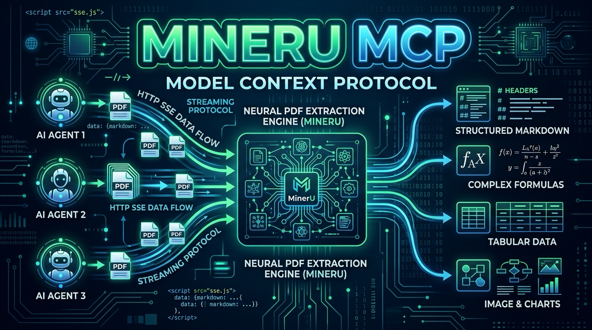

<p align="center">
  
</p>

[English](README.en.md) · **Español**

# MinerU MCP — Extracción y parseo de PDFs para agentes IA vía Model Context Protocol (MCP)

> **Transforma cualquier documento PDF en Markdown estructurado, tablas y código LaTeX para tus agentes IA.**
> Servidor MCP open source que expone las capacidades de extracción de MinerU (`PDF-Extract-Kit` / `MinerU2.5-VLM`) a Claude Code, Cursor, Windsurf, Hermes Gateway y cualquier cliente compatible con [Model Context Protocol](https://modelcontextprotocol.io). FastMCP HTTP/SSE + soporte para path local o Base64, **cero dependencias en clientes, 100% en tu hardware**.

[](LICENSE)
[](https://modelcontextprotocol.io)
[](pyproject.toml)
[](https://github.com/GermaniU/mineru-mcp/actions/workflows/ci.yml)
[](https://github.com/jlowin/fastmcp)
[](CONTRIBUTING.md)

**Tags:** `mcp-server` · `mineru` · `pdf-parser` · `ocr` · `latex` · `ai-agents` · `fastmcp` · `claude-code` · `cursor` · `hermes-gateway` · `local-first` · `self-hosted`

<p align="center">
  
</p>

<p align="center"><sub>El agente manda un PDF por MCP y recibe Markdown con ecuaciones en LaTeX y tablas — MinerU corre en tu server, el cliente no instala PyTorch. Grabado con <a href="scripts/demo_parse.py"><code>scripts/demo_parse.py</code></a> contra un <code>mineru-api</code> real.</sub></p>

---

## 💡 Por qué existe

Extraer texto estructurado, tablas complejas y fórmulas matemáticas de archivos PDF suele requerir entornos Python pesados con PyTorch, OCR y modelos de visión en cada máquina cliente. **MinerU MCP** resuelve esto actuando como un adaptador middleware HTTP/SSE desacoplado:

- 🚀 **Cero Instalación Local**: Cualquier cliente MCP procesa documentos vía HTTP/SSE en puerto `8202` pasando un `file_path` local o enviando el PDF codificado en `file_base64`.
- 📊 **Markdown Estructurado y LaTeX**: Convierte encabezados, listas, tablas complejas y ecuaciones matemáticas en código LaTeX estándar listo para RAG.
- 🧠 **La GPU se comparte, no se pelea**: `pipeline` (default) pide ~1.5 GB de VRAM; `hybrid-engine` y `vlm-engine` ~4 GB y dan más precisión. Si el host tiene el GPU Broker, cada parseo le pide la VRAM antes y la devuelve al terminar, así que convive con un LLM local en la misma tarjeta.

---

## ⚡ Quickstart

`mineru-mcp` es solo la capa MCP: necesitas un `mineru-api` corriendo (`mineru==3.4.4`). Cómo montarlo en el host: [`docs/SERVER_SETUP.md`](docs/SERVER_SETUP.md).

Hay dos formas de correrlo. Elige una:

| Modo | Cuándo | Cómo arranca |
|------|--------|--------------|
| **HTTP** | Un server en la máquina de `mineru-api` que comparten todos los clientes de tu red (el uso principal) | Lo arrancas tú (o un servicio) y queda escuchando en `http://<server>:8202/mcp`. |
| **stdio** | El cliente corre en la misma máquina que `mineru-api` | El cliente lanza el proceso él solo (`uvx` o Docker). No hay puerto abierto. |

### Opción A — HTTP (server compartido)

```bash
git clone https://github.com/GermaniU/mineru-mcp.git
cd mineru-mcp
uv venv && source .venv/bin/activate
uv pip install -e .
MINERU_URL=http://127.0.0.1:8000 mineru-mcp
```

Endpoint MCP: `http://<server>:8202/mcp`. Pégalo en la config de tu cliente (ver [`docs/CLIENTS.md`](docs/CLIENTS.md) — Claude Code, Cursor, Continue, OpenCode, Hermes Gateway).

### Opción B — stdio con Docker

La imagen `ghcr.io/germaniu/mineru-mcp` habla MCP por stdio y llama a un `mineru-api` que corre en el host. Configúrala en tu cliente MCP:

```json
{
  "mcpServers": {
    "mineru": {
      "command": "docker",
      "args": [
        "run", "-i", "--rm",
        "--add-host", "host.docker.internal:host-gateway",
        "-e", "MINERU_URL=http://host.docker.internal:8000",
        "ghcr.io/germaniu/mineru-mcp:latest", "--stdio"
      ]
    }
  }
}
```

Dentro del contenedor `file_path` se refiere al sistema de archivos del contenedor: manda los documentos con `file_base64` + `file_name`, o monta un directorio con `-v`. Sin systemd en el contenedor no hay wake-on-demand ni GPU Broker: `mineru-api` tiene que estar ya arriba.

> Sin Docker: `uvx --from git+https://github.com/GermaniU/mineru-mcp mineru-mcp --stdio` (config en [`docs/CLIENTS.md`](docs/CLIENTS.md#con-uvx)).

### 🔍 Diagnóstico

`mineru_health` dice si `mineru-api` responde, su versión y las tareas en cola, y distingue un backend **dormido** (detenido por inactividad) de uno **roto**. Se puede llamar sin cliente MCP, con el [smoke test con curl](#-smoke-test-con-curl).

---

## ⚙️ Configuración (Variables de Entorno)

Crea un archivo `.env` o exporta las siguientes variables:

| Variable | Valor por Defecto | Descripción |
|----------|-------------------|-------------|
| `MINERU_URL` | `http://127.0.0.1:8000` | URL de `mineru-api`. Solo se aceptan loopback y `host.docker.internal`; con cualquier otro host las tools se niegan a enviar documentos. |
| `MINERU_BACKEND` | `pipeline` | Backend si la llamada lo deja vacío (`pipeline`, `hybrid-engine`, `vlm-engine`). |
| `MINERU_PARSE_METHOD` | `auto` | Método de extracción si la llamada lo deja vacío (`auto`, `txt`, `ocr`). |
| `MINERU_LANG` | `es` | Idioma OCR si la llamada lo deja vacío. |
| `MCP_HOST` | `0.0.0.0` | Host binding del modo HTTP. |
| `MCP_PORT` | `8202` | Puerto del modo HTTP. |
| `MCP_AUTH_TOKEN` | *(vacío = sin auth)* | Si se define, el modo HTTP exige `Authorization: Bearer <token>` en cada request. |
| `MCP_TRANSPORT` | *(vacío = HTTP)* | `stdio` equivale a pasar `--stdio`. |

Qué protege y qué no cada ajuste: [SECURITY.md](SECURITY.md).

---

## 🛠️ Herramientas Expuestas (Tool Reference)

| Tool | Qué hace |
|------|----------|
| `parse_document` | Parseo síncrono (30-120 s) de PDF, DOCX, PPTX, XLSX o imagen a Markdown. Entrada: `file_path` (ruta en el server) o `file_base64` + `file_name`. Opcionales: `backend`, `effort`, `image_analysis`, `parse_method`, `lang`, `formula_enable`, `table_enable`, `start_page`, `end_page`. |
| `submit_parse_task` | Igual que `parse_document` pero asíncrono: devuelve un `task_id`. Para documentos de más de ~50 páginas. |
| `get_task_status` | Estado de una tarea (`pending` / `processing` / `completed` / `failed`). |
| `get_task_result` | Markdown de una tarea ya completada. |
| `mineru_health` | Disponibilidad de `mineru-api`, versión y tareas en cola. |

`start_page` y `end_page` cuentan desde 0: la demo pide `start_page: 4, end_page: 5` y recibe las páginas 5 y 6 del paper. `hybrid-engine` + `effort=high` + `image_analysis=true` convierte figuras en diagramas Mermaid.

---

## 🎯 Alcance actual

MinerU MCP es deliberadamente delgado. Hace **una cosa**: llevar documentos de un cliente MCP a tu `mineru-api` y devolver el Markdown. El parseo lo hace MinerU.

### Lo que SÍ hace
- ✅ PDF, DOCX, PPTX, XLSX, PNG y JPG a Markdown con títulos, tablas (HTML) y fórmulas (LaTeX).
- ✅ Recibe el documento como ruta del server (`file_path`) o como contenido (`file_base64` + `file_name`) desde otra máquina.
- ✅ Parseo síncrono para documentos cortos y asíncrono con `task_id` para los largos, con rango de páginas.
- ✅ Si `mineru-api` está detenido y hay systemd, lo arranca (`systemctl start`) y espera a que responda antes de parsear.
- ✅ Pide y devuelve la VRAM al GPU Broker cuando el host lo tiene.

### Lo que NO hace (todavía)
- ❌ **No incluye `mineru-api` ni los modelos.** Se instalan aparte en el host, con sus servicios: [`docs/SERVER_SETUP.md`](docs/SERVER_SETUP.md).
- ❌ **No manda documentos fuera de tu red.** Si `MINERU_URL` no es loopback, se niega a enviarlos; no usa la API cloud de MinerU.
- ❌ **No devuelve las imágenes extraídas**, solo el Markdown.
- ❌ **No hace streaming parcial** del Markdown en extracciones largas: usa `submit_parse_task` y consulta el estado.
- ❌ **No guarda documentos ni resultados.** El archivo temporal del base64 se borra al terminar.
- ❌ **En Docker no hay wake-on-demand ni GPU Broker:** `mineru-api` tiene que estar arriba.

Si necesitas algo de la lista NO, abre un [issue](https://github.com/GermaniU/mineru-mcp/issues) con un caso de uso real.

---

## 🧭 ¿Y los otros servidores MCP para documentos?

Hay tres familias, y resuelven problemas distintos.

| | **MinerU MCP** (este) | MCP oficial de MinerU (cloud) | Conversores generales (Docling, MarkItDown) |
|---|---|---|---|
| Dónde se parsea | Tu `mineru-api`, en tu hardware | La API cloud de MinerU | La máquina donde corre el MCP |
| Tus documentos salen de tu red | **No** (bloquea URLs externas) | Sí | No |
| Cuenta / token | Ninguno | Token de la API de MinerU | Ninguno |
| Dependencias en el cliente | Ninguna (HTTP) o solo Docker (stdio) | Python (`uvx mineru-open-mcp`) | El motor de conversión completo |
| Comparte la GPU con un LLM local | **Sí** (GPU Broker) | N/A | No |
| Motor | MinerU (`pipeline` / `vlm` / `hybrid`) | MinerU | El suyo propio |

**En una frase:**
- Si no tienes GPU ni servidor y no te importa subir los documentos → el MCP cloud oficial de MinerU.
- Si quieres un conversor que viva en la misma máquina que el cliente → Docling o MarkItDown.
- Si ya tienes (o quieres) MinerU en tu propio servidor y que **los documentos no salgan de tu red**, compartido por todos los clientes de la LAN → este.

---

## 🔌 Conectar tu cliente

Configuración lista para copiar en [`docs/CLIENTS.md`](docs/CLIENTS.md) (HTTP y stdio):

- 🟦 **Claude Code** — `claude mcp add -s user -t http mineru http://<server>:8202/mcp` (las tools aparecen en sesiones nuevas).
- 🟧 **Cursor** — Settings → MCP Servers → Add new MCP Server.
- 🟩 **Continue** (VS Code / JetBrains) — `~/.continue/config.json`.
- 🟪 **OpenCode** — `~/.config/opencode/config.json`.
- 🟨 **Hermes Gateway** — `mcp_servers` en `~/.hermes/config.yaml`.
- 🟫 **Claude Desktop** — stdio con `uvx` o Docker, en la máquina de `mineru-api`.

Snippets listos en [`examples/`](examples/).

---

## 🧪 Smoke test con curl

El modo HTTP es *stateless*: una sola request basta, sin `initialize` ni `mcp-session-id`.

```bash
curl -sS -X POST http://localhost:8202/mcp \
  -H 'Content-Type: application/json' \
  -H 'Accept: application/json, text/event-stream' \
  -d '{"jsonrpc":"2.0","id":1,"method":"tools/call","params":{"name":"mineru_health","arguments":{}}}'
```

Con `MCP_AUTH_TOKEN` añade `-H "Authorization: Bearer <token>"`.

Para la prueba completa (health + parseo real de dos páginas de un paper de arXiv), la demo del GIF:

```bash
MCP_DEMO_URL=http://localhost:8202/mcp python scripts/demo_parse.py
```

---

## 🧱 Arquitectura

> ⚠️ **Límites del sistema:** `mineru-mcp` es **únicamente la capa de transporte e interfaz MCP**. No incluye el motor de procesamiento `mineru-api` ni la descarga en caché de modelos de HuggingFace.

```
 +-------------------------------------------------------+
 |                 Clientes MCP (LAN)                    |
 | (Claude Code CLI / Cursor / Windsurf / Hermes Gateway)|
 +-------------------------------------------------------+
                             |
                             | HTTP / SSE (Puerto 8202)
                             v
 +-------------------------------------------------------+
 |                   mineru-mcp Server                   |
 |        (FastMCP + File Path / Base64 Decoder)         |
 +-------------------------------------------------------+
                             |
                             | Loopback HTTP (Puerto 8000)
                             v
 +-------------------------------------------------------+
 |                  MinerU Backend Host                  |
 |  (mineru-api + PDF-Extract-Kit + HuggingFace Cache)   |
 +-------------------------------------------------------+
```

Cada tool vive en `src/mineru_mcp/tools/`; `server.py` solo las registra en FastMCP y arranca el transporte. Detalle técnico en [`docs/ARCHITECTURE.md`](docs/ARCHITECTURE.md).

---

## 🤝 Contribuye

PRs, issues y forks bienvenidos (MIT).

**Reglas (resumen):**
1. **Cambios chicos y directos.** Toca el camino de código más angosto que explica el problema.
2. **Sin abstracciones especulativas** ni dependencias nuevas que no hagan falta.
3. **Nombres y parámetros de las tools se preservan:** los clientes dependen de ellos.
4. **Identifiers en inglés**, comentarios y commits en español. Conventional Commits (`feat:`, `fix:`, `docs:`, `refactor:`, `test:`, `chore:`).

Detalle completo en [`CONTRIBUTING.md`](CONTRIBUTING.md).

```bash
uv venv && source .venv/bin/activate
uv pip install -e ".[dev]"
pytest          # unit tests, sin mineru-api
ruff check .
```

---

## 🩹 Troubleshooting

**`mineru_health` responde `MinerU no disponible (el backend está inactivo)`**
- `mineru-api` está detenido (por ejemplo, por un watchdog de inactividad que devuelve la VRAM). No es un error: `parse_document` o `submit_parse_task` lo arrancan.

**`BLOQUEADO por seguridad: MINERU_URL apunta a …`**
- `MINERU_URL` no es loopback ni `host.docker.internal`. Es a propósito: los documentos no salen de tu máquina. Ver [`SECURITY.md`](SECURITY.md).

**`MinerU no responde en … y aquí no hay systemd para arrancarlo`**
- Corres en Docker o macOS: no hay forma de despertar `mineru-api`. Arráncalo a mano y reintenta.

**`406 Not Acceptable` al hacer `curl` al endpoint**
- Falta el header `Accept: application/json, text/event-stream`.

**`401 {"error":"unauthorized"}`**
- El server tiene `MCP_AUTH_TOKEN`: manda `Authorization: Bearer <token>`.

**`Error: timeout. El documento puede ser muy grande`**
- Usa `submit_parse_task` y consulta con `get_task_status`, o parsea por rangos con `start_page` / `end_page`.

---

## 📚 Documentación

- [`docs/SERVER_SETUP.md`](docs/SERVER_SETUP.md) — instalación de `mineru-api`, modelos y servicios en el host.
- [`docs/CLIENTS.md`](docs/CLIENTS.md) — config para Claude Code, Cursor, Continue, OpenCode, Hermes Gateway y Claude Desktop.
- [`docs/ARCHITECTURE.md`](docs/ARCHITECTURE.md) — componentes, flujo de una petición y GPU Arbiter.
- [`SECURITY.md`](SECURITY.md) — modelo de amenazas y cómo reportar vulnerabilidades.
- [`CONTRIBUTING.md`](CONTRIBUTING.md) — entorno de desarrollo, reglas de estilo y flujo de trabajo.
- [`CHANGELOG.md`](CHANGELOG.md) — historial de cambios.

---

## 📄 Licencia

[MIT](LICENSE) — úsalo, fórkalo, mejóralo.

---

**Hecho por [@GermaniU](https://github.com/GermaniU).** Si te sirvió, una ⭐ ayuda a que más gente lo encuentre. Si algo se rompió, abre un issue y lo arreglamos.
